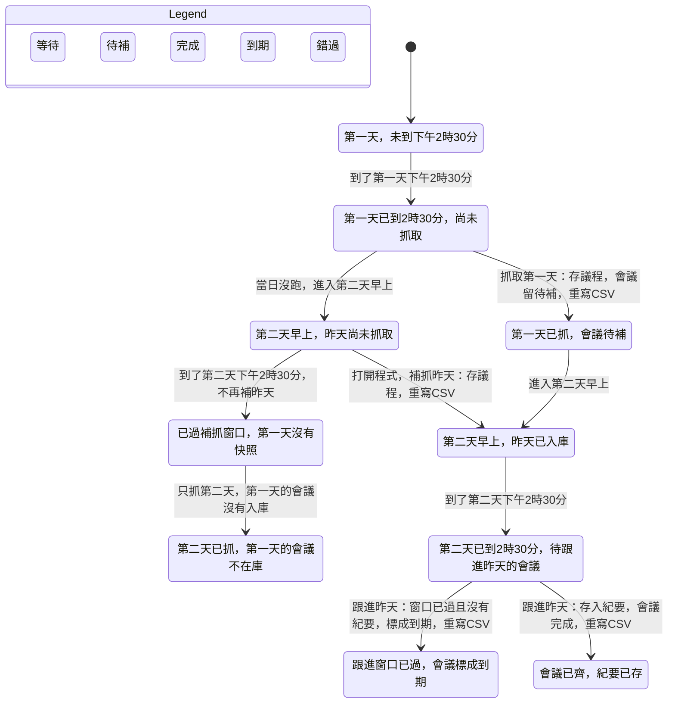

# 每日會議抓取計劃

這份文件決定每日如何把立法會當日會議放進資料庫。

每日工作在香港時間下午 2 時 30 分跑一次。它先存當日議程和會前文件。會議紀要、表決和較後才出現的文件留到之後的日子補。

## 每日索引讀 Tmeeting

[立法會日誌](https://www.legco.gov.hk/tc/legco-business/useful-information/legco-calendar.html) 的 HTML 沒有會議清單。頁面留空，由 `/cs/scripts/legco-calendar-bundle.js` 在瀏覽器裡填上。該程式連到 `https://ws1.legco.gov.hk/signalr`。

開放數據 [Tmeeting](https://app.legco.gov.hk/ScheduleDB/odata/Tmeeting) 在 2026-11-17 回了兩筆。兩筆的中文議程網址就是這兩條。

- https://www.legco.gov.hk/yr2026/chinese/panels/ci/agenda/ci20261117.htm
- https://www.legco.gov.hk/yr2026/chinese/bc/bc106/agenda/bc10620261117.htm

每日索引讀 Tmeeting 裡 `start_date_time` 落在當日香港日期的列。委員會名稱只存 `subject_chi`。議程頁上的委員會名稱不另存一欄。

## 下午 2 時 30 分存議程，紀要留待補

工商及創新科技事務委員會 11 月 17 日議程的頁腳寫立法會秘書處 2026 年 11 月 16 日。《2026年調解(修訂)條例草案》委員會那份寫 2026 年 11 月 17 日。同一天才發出的議程，早上的工作會錯過。下午 2 時 30 分是為了接住當日發出的議程。文件在幾點放上網站，這次沒有量度。

當日議程頁有項目標題和會前文件連結。頁上沒有會議紀要，也沒有表決結果。

實測如下。

- `panels/ci/minutes/ci20261117.pdf` 在 2026-11-19 是 404。
- `panels/ci/minutes/ci20261020.pdf` 是 PDF。回應的 Last-Modified 是 2026-10-30。10 月 20 日的紀要，10 日後才在伺服器上。
- `bc/bc106/minutes/bc10620261030.pdf` 是 PDF。
- 立法會會議沒有對應的 minutes PDF。`counmtg/floor/cm20261111-confirm-ec.pdf` 是 PDF，約 17MB。這是會議過程紀錄，不是短紀要。
- [vVotingResult](https://app.legco.gov.hk/vrdb/odata/vVotingResult) 在 `vote_date` 為 2026-11-18 和 2026-11-19 時有 Council Meeting 列。每一列是一位議員。同一議案的 `motion_ch` 和 `overall_result` 在這些列上重複。
- `counmtg/voting/v20261111.pdf` 和 `v20261118.pdf` 是 PDF。`vote_date` 等於 2026-11-11 的查詢沒有列。延續會議是另一個 `meet_id`，共用第一天的議程網址。

未完成的會議會在其後的每天下午再讀一次。窗口是會議日起 21 日。21 來自上面那份 10 日後才出現的紀要，再留餘地。這是選擇，不是量到的上限。窗口最後一日仍沒有紀要，`status` 標成 `expired`。

## 為何分成四張表

第一種形狀是一場會議一列。議程、文件和議案都放在該列的清單裡。議程解析和表決解析都寫這一列。重跑要整列重寫。

第二種形狀是四張表。會議、議程項目、文件、議案各有一個寫入者。

用第二種。議程解析只寫議程項目和會前文件。表決解析只寫議案。重跑按主鍵更新。

不存每位議員一列。開放數據有議員姓名。這裡要的是議案名稱和通過或否決，所以摺成一筆議案。CSV 只寫這筆結果。

不抽取 PDF 文字。PDF 檔本身要存下來。來源網址仍寫在 `url`。

## 四張表

`meeting` 的主人是 Tmeeting 的 `meet_id`。

- `meet_id`
- `meeting_date`，香港日期
- `start_time`
- `committee_name`，即 `subject_chi`
- `agenda_url`
- `venue_name`
- `meeting_type`
- `follow_up_until`，`meeting_date` 加 21 日
- `status`，`open`、`complete` 或 `expired`

`agenda_item` 的主人是一場會議裡的一個項目。

- `meet_id`
- `item_key`，例如 I 或 II
- `title`

主鍵是 `meet_id` 加 `item_key`。

`document` 的主人是一場會議裡的一份文件。

- `meet_id`
- `role`，`agenda_paper`、`minutes`、`voting_sheet` 或 `later_paper`
- `paper_label`，例如 `CB(2)1517/2026(01)`。沒有編號就空着
- `title`
- `url`。只限委員參閱、頁上沒有連結時是空
- `local_path`。當日已在網站上的 PDF 才有值。否則是空

主鍵是 `meet_id`、`role`，再加 `paper_label` 或 `url`。

PDF 的路徑是 `data/` 加會議類別，再加 `committee_name`，再加 `meeting_date`，再加網址最後一段檔名。`committee_name` 就是 `subject_chi`，包含結尾的「會議」。類別由議程網址決定，不跟文件網址裡的另一個委員會走。重跑寫入同一個路徑。

類別如下。

- `大會`：網址含 `/counmtg/`，或名稱含「立法會會議」。延續會議用當日的名稱，仍放在大會下面。
- `財務委員會`：網址含 `/fc/`，包括財務委員會、工務小組委員會、人事編制小組委員會。
- `事務委員會`：網址含 `/panels/`。
- `法案委員會`：網址含 `/bc/`。
- `內務委員會`：網址含 `/hc/`，包括內務委員會及其小組委員會。

2026-11-09 下午 2 時 30 分會寫入的例子如下。

- `data/事務委員會/福利事務委員會會議/2026-11-09/ws20261109cb1-1387-1-c.pdf`
- `data/事務委員會/資訊科技及廣播事務委員會會議/2026-11-09/itb20261109cb2-1428-1-c.pdf`
- `data/事務委員會/民政及文化體育事務委員會會議/2026-11-09/ha20261109cb3-1314-1-c.pdf`

該日《2026年醫生註冊(修訂)條例草案》委員會沒有可存的 PDF。紀要要等到檔案在截止時間前已在網站上，才寫入 `data/{類別}/{委員會}/{日期}/`。日期和委員會跟網址走：食物安全的紀要即使由工務小組委員會的議程連結，也放在食物安全事務委員會自己的日期資料夾。同一份網址只留一份檔。會議名稱後面的時間備註不另開資料夾。例如 `data/事務委員會/福利事務委員會會議/2026-11-09/ws20261109.pdf`。

`motion` 的主人是一場會議裡的一次表決。

- `meet_id`
- `vote_type`
- `vote_number`
- `motion_title`
- `result`
- `vote_time`

主鍵是 `meet_id`、`vote_type`、`vote_number`。不存議員姓名和個別投票。

11 月 17 日法案委員會議程有「只限委員參閱」而沒有連結的文件，例如 `CB(3)1397/2026(02)`。這一列仍存編號和標題，`url` 留空。

## 資料在邊界解析

HTTP 和 HTML 在邊界收成上面的列。邊界之內不再檢查空值。

- `parseMeeting` 讀 Tmeeting 一列，得到 `meeting`。
- `parseAgenda` 讀議程 HTML 的 `data-unit`，得到 `agenda_item`，以及 `role` 為 `agenda_paper` 的 `document`。以 `/` 開頭的連結補上 `https://www.legco.gov.hk`。
- `foldVotes` 把同一 `vote_type` 和 `vote_number` 的議員列摺成一筆 `motion`。議員姓名不留。
- `minutesUrl` 由議程網址和日期推出紀要位址，再請求確認。推不出或不是 200，就留空。
- `votingSheetUrl` 只對立法會會議試 `counmtg/voting/v` 加日期的 PDF。

紀要位址來自下面三個實測例子，不是從議程頁的連結讀到的。

- 事務委員會是 `/yr2026/chinese/panels/{code}/minutes/{code}{YYYYMMDD}.pdf`。`ci20261020.pdf` 曾回 200。
- 法案委員會是 `/yr2026/chinese/bc/{code}/minutes/{code}{YYYYMMDD}.pdf`。`bc10620261030.pdf` 曾回 200。
- 立法會會議用 `/yr2026/chinese/counmtg/floor/cm{YYYYMMDD}-confirm-ec.pdf` 當會議紀錄連結，`role` 仍是 `minutes`。`cm20261111-confirm-ec.pdf` 曾回 200。

新的委員會種類若得到 404，就留空，下一輪再試。不猜第二條路徑。

表決接到會議的規則如下。`vote_date` 的日期等於 `meeting_date`，而且 `vote_type` 是 Council Meeting 時，接到當日 `subject_chi` 含「立法會會議」的 `meet_id`，包括延續會議。其他 `vote_type` 只在名稱能對上 `committee_name` 時才接。對不上就不掛。延續會議的表決掛在表決當日那一筆 `meet_id`，不掛回第一天。CSV 只寫通過或否決，不寫每位議員。

## 每天下午的一輪

時區是 `Asia/Hong_Kong`。每日 14:30 跑一次。14:30 之前不讀議程。

執行命令是 `python3 scripts/ingest.py`。不帶日期就用香港當天。`--date YYYY-MM-DD` 重跑該日下午 2 時 30 分的一輪，並跟進仍未完成、窗口未過的舊會議。2 時 30 分之前呼叫會直接返回，不讀議程，也不寫檔。資料庫是 `data/legco.sqlite`，不納入版本庫。

時鐘是 GitHub Actions。`.github/workflows/daily-ingest.yml` 在 UTC 06:30 啟動，也就是香港時間 14:30。GitHub 可能遲幾分鐘才開跑。本地打開程式和這條排程用同一條命令：`python3 scripts/ingest.py`。

不帶日期時，程式只補最近一個已過 14:30、而 `data/YYYY-MM-DD/snapshot.json` 仍未存在的日子。14:30 之前，這一天是昨天，所以電腦在 14:30 沒開、或者排程遲過香港午夜才啟動，都會補抓錯過的那一天，而不會提前讀今天。快照已在就不再重跑。`--date YYYY-MM-DD` 仍是指定重跑那一天，即使快照已在也會再跑；指定日的 14:30 之前則直接返回，不寫檔。可以在 Actions 頁手動跑，並填 `date`。

這條工作不需要倉庫密鑰。立法會的資料是公開的。它用 Actions 自帶的 `GITHUB_TOKEN`，權限是 `contents: write` 和 `pull-requests: write`。有改動就推上 `ingest/YYYY-MM-DD`，再開一條拉取請求，不直接寫 `main`。下載失敗時，已經寫下的快照和 CSV 仍會進那條請求，工作本身標成失敗。

一輪的順序如下。

1. 讀當日 Tmeeting。按 `meet_id` upsert `meeting`。新會議的 `status` 是 `open`。
2. 再取出 `status` 仍是 `open`、而且 `follow_up_until` 尚未過去的舊會議。
3. 對每一場讀 `agenda_url`。upsert 議程項目和 `agenda_paper`。主鍵已在就更新標題和 `url`。已在網站上的 PDF 寫入 `local_path`。
4. 試紀要位址。截止時間前已在網站上，就 upsert `role` 為 `minutes` 的文件。PDF 放在網址所屬的委員會和日期；這個資料夾裡已有同一檔名就沿用，不另存一份。
5. 讀當日 `vVotingResult`，摺成 `motion`，掛到對得上的 `meet_id`。只留議案和整體結果。
6. 立法會會議再試表決 PDF。200 就 upsert `voting_sheet`。
7. 議程上新出現、又不是上面幾種的連結，用 `later_paper` 插入。
8. 這一輪存到紀要，就把 `status` 改為 `complete`。`follow_up_until` 已過而仍然沒有紀要，就改為 `expired`。沒有表決的會議也可以 `complete`。事務委員會常常沒有表決。
9. 重寫 `data/meetings.csv`。每次抓取都要做。寫了快照而沒有重寫這份 CSV，這輪不算完成。當日沒有會議也要重寫，只是該日沒有新列。

找到紀要的那一輪會先再讀議程，所以和紀要同一輪出現的新文件會一併寫入。紀要入庫之後才放上的文件，這一版不再回頭。表決通常早於紀要。11 月 18 日和 19 日的 Council Meeting 列在紀要 PDF 出現之前已經能查到。

同一 `meet_id` 再跑不會多一列會議。議程存了就留着，只做更新。中途停掉時，下一輪看資料庫裡已經有的列，不看上一輪打算做到哪裡。

## 會議文件 CSV

`data/meetings.csv` 把已抓取各日的議程文件和表決合成一張表，方便直接打開。它不是另一張資料表。會議紀要和表決結果 PDF 不在這張表。同一份檔在議程上出現兩次，就寫兩列。截止時間後的表決留在快照的 `votes_after_cutoff`，不寫進 CSV。

`紀錄種類` 把列分開。

- `議程文件`：議程上的一份文件，`role` 為 `agenda_paper`。
- `表決結果`：一項在下午 2 時 30 分前已投完的議案，寫整體結果。不寫每位議員的投票。

欄位如下。某一類用不到的欄留空。

- `紀錄種類`
- `日期`
- `時間`，會議開始時間，寫成 `HH:MM`
- `地點`
- `委員會名稱`
- `議程項目`，項目編號加議程上的項目標題
- `文件名稱`，議程連結上的文字
- `網址`
- `本地路徑`。截止時間前未在網站上的 PDF，以及不是 PDF 的連結，留空
- `表決編號`
- `議案`
- `整體結果`，通過或否決
- `表決時間`，寫成 `HH:MM:SS`
- `下載時間`，這份 PDF 寫入本地的時間，ISO 8601，含時區。沒有本地檔就留空
- `SHA256`，本地 PDF 的 SHA256，十六進位。沒有本地檔就留空

來源是 `data/` 下每個 `snapshot.json`。規則是每次抓取都重寫這一份，不另存一日一份。`fetch_day.py` 寫完當日快照後必定重寫它。快照若不是寫在 `data/` 底下，程式會停下來，不讓這輪在沒有更新 CSV 的情況下結束。`python3 scripts/export_meetings_csv.py` 可以單獨再重寫一次。檔案是 UTF-8，開頭有 BOM。議程頁在截止時間後才修改的會議沒有文件列。2026-11-08 沒有會議，所以沒有列。

## 狀態圖

模型只有第一天的一場會議。第二天同時是下一個日曆日，也是這場會議跟進窗口的最後一天。實作的窗口是 21 日。圖把它收成下一天，免得狀態太多。

第一天 14:30 時紀要未公布。若當天有跑，會議留在待補。第二天 14:30 的跟進有兩個結果：紀要已在網站上，會議完成；窗口已過而且仍然沒有紀要，會議標成到期。若第一天沒跑，第二天早上打開程式會補抓昨天。若一直拖到第二天 14:30 才打開，補抓窗口已關，程式只抓第二天，第一天的會議不會入庫。

TLC 到達 10 個狀態、13 步。圖畫 10 個狀態和 10 條箭。圖藏起三個結束狀態上「已經做完、停住」的那一步。打開程式時快照已在、因此什麼都不寫的那一步也沒有畫，因為它停在同一個狀態。

下面的規則都成立。

- 今天下午 2 時 30 分之前不寫今天的快照。昨天可以在今天 2 時 30 分之前補上。
- 有寫入快照的一輪，同一輪重寫 CSV。沒有寫入就不改 CSV。
- 紀要不早於議程入庫。
- 會議標成完成，當且僅當紀要已存。
- 標成到期時，紀要仍未存，而且已經做過第二天的跟進。
- 待補時議程已存、紀要未存、第二天的快照尚未寫。
- 議程入庫之後一直留着。完成和到期都不會回到待補。
- 在公平執行下，第二天最終會寫下自己的快照。

圖檔在 `docs/daily-meeting-ingest/chart.mmd` 和 `docs/daily-meeting-ingest/chart.svg`。規格在 `docs/daily-meeting-ingest/DailyIngest.tla`，標籤在同目錄的 `view.ts`。再跑一次時，`--out` 必須是空目錄。這次檢查寫入 `/tmp/legco-daily-ingest/out`。程式輸出把逗號寫成 `#65292;`、把冒號寫成 `#65306;`。上面的圖和 `chart.mmd` 改回原來的標點，箭和狀態沒有改。

模型沒有多場會議、表決、超過 100 MB 的 PDF、網路失敗，也沒有把一輪拆成讀清單、下載、計算 SHA256 這幾步。那些都收在寫入快照的同一條箭裡。`--date` 指定重跑某一天也不在圖裡。

## 這一版不做的事

不抓英文頁。不存議員逐一的表決。不抽取 PDF 文字。不猜第二條紀要路徑。
